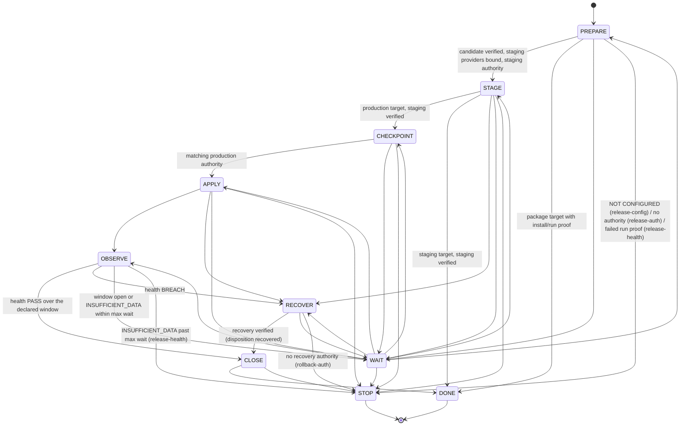

# Architecture

aidlc is a library plus CLI. The library holds pure decision engines (state machines and
policies over persisted facts), a small durable state layer, coordination primitives for
multiple sessions, probes and adapters for real project tools, and the artifact chain of the
Anthropic playbook. The CLI exposes one typed directive per call and commits results.

## Module map

`src/loop/run-driver.ts` dispatches controller directives to a command-capable provider and rereads persisted state. It treats a saved reset on the goal review pool as a hold for any waiting card, even without a queue request; other pools require a current-candidate request. One runner per goal is supported at a time. The CLI binds the worker to the absolute state root and the driver's resolved session identity, and sets an execution-scoped no-ship flag. `CardRunner` refuses native shipping before merge intent or adapter invocation when that flag is set; ordinary operator commands retain shipping. The flag is a trusted-worker command guard, not a hostile-code sandbox.

`src/core/` holds the decision engines. `types.ts` defines every persisted record as a zod schema (Goal, CardRun, ReleaseAttempt, JournalEvent, Lease, ReviewRequest, OperationRecord, AuthorizationRecord, EffortEpisode) plus the constants for limits. `router.ts` classifies a request into size, kind, delivery target and modules. `deadlines.ts` computes goal/card admission deadlines and the reconciliation grace. `stop.ts` builds STOP records (`makeStop`, whose `global` defaults to true for `auth`, `audit`, `cancelled`, `ownership`, `risk`, `frozen` and `time`), the next action of a stop nothing lifts (`toolStopNextAction`) and their one-line rendering (`formatStop`). `effort.ts` bounds implementation attempts (MA2). Build directives name an attempt by `ladderNumber`, the records before it that are not `not-counted` plus one; the stored attempt numbers and the journal's numbering are unchanged (card T0-ATTEMPT-NUMBER). `review-effort.ts` selects the effort level an R3 reviewer's `{effort}` placeholder expands to from the candidate's changed lines and paths. `review-policy.ts` parses scaffold verdicts, classifies them, keeps the R3 decision ledger (two decisions, up to four for a command reviewer's repairs; `repeatedFindings` names the re-raise of a disputed finding that stops) and the finding bookkeeping (ids, `re:F<n>` re-raises, dispositions, the same-candidate rule, deadlocks, the `(class: <slug>)` defect class and `blockClasses`, the class list a formal repair directive appends). `parse-guard.ts` holds the control decisions read from process output: `nulList` splits a `-z` name listing on NUL only, and `detectQuotaHold` decides a quota hold from a provider's numeric error status first, else from one word rule, and names the path that decided. `ci-policy.ts` classifies CI failures and allows one persisted transient rerun. `health.ts` evaluates PASS/BREACH/INSUFFICIENT_DATA. `authorization.ts` binds approvals to candidate, environment and effects. `arc.ts` picks the next wave of cards; a `depends_on` id outside the goal's projection is satisfied only by the outcome the caller vouches for, which `GoalController.cardOutcomes` derives from the card registry's merged status (the rule `computeRevision` applies when it admits such a projection), and is itself never ordered, dispatched or reported. `goal-machine.ts`, `card-machine.ts` and `release-machine.ts` are the three state machines. `migrate.ts` detects data impact and builds the expand/deploy/backfill/verify/contract graph. `amendments.ts` routes live requirement changes. `roles.ts` resolves model/effort profiles per role (Claude defaults: `claude-opus-5-5` for planner, implementer, reviewer and release-specialist, `claude-sonnet-5-5` for the investigator; the Claude effort ladder in `effort.ts` is low, medium, high, xhigh, max).

`src/state/` is persistence. `paths.ts` resolves the canonical state directory (`<git common dir>/../.aidlc`, override `AIDLC_STATE_DIR`). `store.ts` writes JSON atomically (temp file + rename, interrupted-write detection) and owns the one read-modify-write, `updateJson`: an exclusive lock file per record (`<file>.lock`, naming its process) with an ownership-checked write and release, the deadline checked before every retry acquisition, no lock removed but by the writer that created it (a lock whose owner process is gone is refused with the file and the process id named), a lock read or removal failure after the change never replacing the change's result or error, no write when the change throws or returns the record unchanged, and a `within` section that holds another lock until the write lands; `goal-store.ts` runs every card-run write through it (`updateCardRun`; `saveCardRun` is a compare-and-set on `CardRun.revision`, bumped by every write under the lock, so a snapshot read before another write landed is refused whatever it changes, with the ledger entry named when one is missing, un-decided, resurrected or regressed) and `lease.ts` every lease write. `journal.ts` is the append-only hash-chained event log and the process actor identity; `Journal.append` reads the head and appends in one `updateJson` section of the journal lock (`<goalId>.jsonl.append.lock`, record path `<goalId>.jsonl.append`, never written), which is the innermost lock: an append takes no other lock while it holds it, a caller holding the card-run, a lease, the review-queue or the manifest lock takes that lock first, and an append reached from inside another append waits and is refused with `LOCKED` (card T0-JOURNAL-APPEND-LOCK); the session id comes from `AIDLC_SESSION`, then the Claude Code session (`CLAUDE_CODE_SESSION_ID`, exported to Claude Code's subprocesses), then a per-repository default token in `.aidlc/session-default` (single-controller interim mode); a hook process takes it from the hook event's `session_id` (`hooks/index.ts`). An identity change rewrites no lease record: a lease claimed under the default token by an earlier version, or by a Claude Code session that has ended (a `/clear` starts a new one), stays as recorded and expires after its TTL; `aidlc goal takeover` then takes the goal lease after the old owner's operations are reconciled. The session that closes the goal does the same before it saves DONE (`GoalController.nextInClose`), in two lease sections that judge the locked record: the takeover journals a handoff intent before the lease write, and the release journals `GOAL_TAKEOVER` from that intent when it is still missing, as does the takeover for the lease it replaces, so a goal finished by a session other than the intake session reaches DONE with its board and `done` directive, and a close interrupted between the two is completed by the next call, of the same session or a later one. A card lease held by an ended session is continued while it is live by a process running with `AIDLC_SESSION` set to the owner session id, which `aidlc card status` prints from the lease record, provided the run's `ownerGeneration` equals the lease generation (the renewal in `loop/card-runner.ts` requires it; a run interrupted between the lease claim and the PREPARE save has none), since a run stopped for ownership before PREPARE carries the generic stale-generation detail. Once it has expired, `aidlc card takeover` (`CardRunner.takeover`) takes it after the card's operations in every goal are reconciled, in one lease section (`LeaseStore.update`) that checks the lease record and the operation ledger, journals the handoff intent and writes the lease, the lock a ship's fence, duplicate check and operation intent take too: the generation advances and the old owner is fenced; then, under the card-run lock and the lease lock inside it, both held until the run record is on disk, the run records the new generation (the run without one included) and one `LEASE_ACQUIRED` per generation is journaled, only while the lease is still this session's acquisition and the locked run does not carry the generation yet, so a stop saved meanwhile stays; its state is selected again through the evidence gathering `next` shares with it, which reads the stored run and never a caller's snapshot (a stale dispatch writes nothing back and a persisted blocking stop stands), and whose renewal revalidates the ownership stop; a missing or released lease, a lease this session holds at the run's generation, a live lease of another session and an unresolved operation refuse it before any write; the handoff intent (`NOTE`, `card-takeover-intent`) and the acquisition are resolved by resource and generation across every goal's journal, so a lease this session holds at a generation the run does not carry is an interrupted takeover the command completes, naming the previous owner from the intent. `next` reads the stored run before its plan-checkpoint guard as well, and lifts an ownership stop whose lease is absent or released (never one merely expired) so the claim is reachable; `recordAttempt` saves onto the stored run too but applies no fence; the handoff intent is bound to the acquiring session and the acquisition time the lease carries, and an acquisition PREPARE journaled counts as the one. Lock order is the card-run lock, then the lease lock: no card-run lock is taken inside a lease section, and neither lock is reentrant; `docs/OPERATIONS.md` (Sessions) states what stays unfenced and the windows that remain. `goal-store.ts` persists goals, card runs and release attempts. `claims.ts` derives, from the goal records alone, which non-terminal goal claims each planning file on the main checkout (its intent, the spec and plan of the intent's slug, its plan reference, the card file of every card it lists or its plan's task split names; the older goal keeps a path two goals claim) and selects the uncommitted ones from a `git status` of the main checkout; `aidlc doctor` (`workingTree`) prints them with the claiming goal's lease state and the Stop hook asks the session holding a goal's lease to commit that goal's files (no claims file, no second lock: the goal lease is the owner). `bounds.ts` backs `aidlc bounds`: it counts each loop bound that fired from the goal and card-run records, reading each file on its own with no snapshot across files and writing nothing, with the current outcome of the goal that hit it; a time STOP that `aidlc goal extend` lifted is not counted. `board.ts` renders the Markdown board, which is a view, never a store; its Arc line reports the arc the controller decided, so the caller hands it the outcomes it resolved (`prerequisitesClosedElsewhere`) and `aidlc board` prints the one text it writes rather than a second render of its own. `readWatch` and `renderWatch` back `aidlc board --watch`: each tick reads the goal, its card runs, the goal and card leases and the registry ids through read-only accessors, turns a read failure into its store error code on that row, and renders a screen whose record text passes one encoding point (a plain identifier as is, anything else as `asciiJson`); the watch never calls `next`, the controller, `currentActor` or the journal, and writes nothing (`docs/OPERATIONS.md`, Watching a goal).

`src/coordination/` is package S of the plan. `lease.ts` provides atomic claims with generations, heartbeat, release, takeover-after-reconciliation (exposed as `aidlc goal takeover` and `aidlc card takeover`) and fencing. `review-queue.ts` is the shared provider/account admission queue. A card-run command whose `REVIEW_ADMITTED` append fails after the queue admitted its request cancels that request, freeing the slot (card T0-REVIEW-ADMIT-STRAND). `ReviewQueue.admit` with a request key admits only that request, and only once fewer requests are ahead of it than the pool has free slots, which is how the card runner asks (card T0-REVIEW-ADMIT-FOREIGN). `reconcile.ts` is the operation ledger: intent before issue, reconciliation by provider lookup, explicit UNKNOWN. The card runner's ship continues under an `intended` merge intent that an earlier failed ship of the same candidate left, instead of recording a second one (card T0-OP-INTENT-DUP).

The release runner matches a release step's ledger records by goal and the exact idempotency key `<attemptId>:<step>:<candidateDigest>` alone, reads them and records the step's intent only when there is none in one section of the environment lease lock, and takes the last terminal match as the step instead of issuing it again (card T0-RELEASE-OP-REISSUE).

`src/probes/` gathers evidence. `exec.ts` runs commands and returns receipts (exit, output digest, timing), the async runner ending a timed-out command's whole process tree and `runSync` with `killTree` running the command under `exec-tree-helper.ts`, which applies that tree kill, with a scripted runner for tests. `git.ts` reads worktrees, HEAD, status, base resolution, divergence and containment. `base-sync.ts` compares the local base branch with `origin/<base>` for `aidlc doctor`, reading refs only and never fetching. `gh.ts` resolves PR identity, run views and check runs with pagination. `hook-wiring.ts` gives `aidlc doctor` its `hookCommand` line (`hookWiringReport`): whether the file that the hook dispatcher in `.claude/settings.json` starts exists, checked without starting a process.

`src/delivery/` touches the project. `worktree.ts` decides start vs attach vs stop from branch, path, common directory and owner record. `ship.ts` defines the ship path interface, classifies `task.ps1` sentinels for the scaffold adapter and provides a dry-run path. `ops.ts` loads `aidlc.ops.json` (operation roles, bindings, environments, health signals) and executes or looks up bound operations.

`src/artifacts/` is the playbook artifact chain. `frontmatter.ts` parses the scaffold's front matter conventions. `card.ts` parses, validates and renders task cards and computes the tier. `intent.ts`, `spec.ts` (EARS classification) and `plan.ts` (definition-of-ready gates, task-split parsing) cover stages 1-3.

`src/providers/` abstracts model calls: `types.ts` (interface, invocation ids, JSON extraction), `mock.ts`, `claude-api.ts` (Anthropic SDK, default model `claude-opus-5-5`, adaptive thinking, an explicit `output_config.effort` on every request and none of the settings Opus 5.5 rejects, quota/refusal outcomes, an injectable messages client for tests), `claude-code.ts` (`claude -p --output-format json`; an `is_error` payload is an error, or a quota hold by its `api_error_status`). `claude-code.ts` adds `--effort <level>` after the model only when it is constructed with `forwardEffort` (the `claudeCode.forwardEffort` key, which `aidlc run` and `aidlc evals run` both read); when disabled, aidlc does not synthesize an effort argument, and existing extra arguments, environment and Claude Code settings remain effective; with `forwardEffort` on and `CLAUDE_CODE_EFFORT_LEVEL` among the keys of its launch environment it starts no process and returns an error. For calls that pass the pre-launch checks, a request with `recordToolCalls` runs `claude-code.ts` with `--output-format stream-json --verbose` and gets the `tool_use` blocks of the run as `toolCalls`; the `result` event is read as the payload, and a stream with no `result` event is an error.

`src/maintain/` closes the loop: `bands.ts` (rolling baseline, Western Electric rules, tiers from `bands.yaml`), `incident.ts` (deduplicated incident ledger and intent.md writer).

`src/evals/runner.ts` loads `evals/*.json` (refusing a prompt that names the measurement), runs an optional model step and deterministic checks, including checks over the tool calls the model made, and gates on a pass rate; a model-backed case runs in a detached temporary checkout of HEAD with an empty temporary `AIDLC_STATE_DIR`, both removed afterwards; `runTrials` runs the cases n times, with `--variant` alternating a checkout of HEAD and one of the ref, and gives the `compareTrials` verdict for HEAD against the ref on the pass rate (docs/OPERATIONS.md, Evals).

`src/review/bench.ts` is the reviewer bench (`aidlc review bench run` and `aidlc review bench export`): the run scores a stage's primary reviewer on the confirmed cases under `evals/review/`, each candidate reviewed once in a detached temporary checkout through the loop's own prompt and panel functions, the export drafts unconfirmed cases from the card runs `src/cli/main.ts` hands it and pins each candidate under `refs/aidlc/bench/`, and the module imports nothing from `src/state/`, `src/coordination/` or `src/loop/` (docs/OPERATIONS.md, Reviewer bench).

`src/core/trial-compare.ts` is the pure verdict of `aidlc review bench compare` and of `aidlc evals run --variant`: `trialRange` gives the median, minimum and maximum over trials, and `compareTrials` returns `better`, `worse`, `no-measurable-difference` or `inconclusive` with a one-line reason, deciding by recall, then by the false-block rate, only when the two ranges do not overlap; the names it takes can drop the second metric, as the eval variant run does with the pass rate in the place of recall. `src/review/bench.ts` builds the `summary` it reads with `--trials <n>`.

`bench/` (outside `src/` and never shipped) holds the loop benchmark: `npm run bench` counts the modules, fs calls, child processes and output of each hook event and the CLI start, and compares them with the ceilings in `bench/baseline.json` (docs/OPERATIONS.md, Loop benchmark).

`src/audit/` provides the evidence manifest with sealing (`manifest.ts`) and the independent verifier (`verifier.ts`).

`src/config.ts` defines `ProjectConfig`, the zod schema of `aidlc.config.json` and its defaults; `loadProjectConfig` reads the file (an absent file gives the defaults, and one that is not JSON or fails the schema throws `ConfigError`) and `resolveWorktreeRoot` gives the directory card worktrees are created under. `src/index.ts` is the library entry point (`main` in `package.json`, built to `dist/index.js`) and only re-exports modules.

`src/hooks/index.ts` implements the six Claude Code guards; `src/hooks/entry.ts` runs every guard that applies to an event in one process (`bin/aidlc-hook.js`, `aidlc hook auto`), so a tool call costs one node start. `src/hooks/lazy.ts` loads the modules only some hook events need (the router, the goal, lease and journal stores, and the planning claims, which alone load yaml) on a guard's first use, through `require` with the extension of its own file (card T0-HOOK-LAZY-2). Every `PreToolUse` or `UserPromptSubmit` event, whichever guards apply, first renews the card leases of the event's session on this host that have less than half of their TTL left (`renewSessionCardLeases`, through `LeaseStore.heartbeat` at each lease's generation), reading the lease files with node:fs once per UTC minute window per session (a marker under `<state>/heartbeat/` holds the window of the last scan) and loading the lease store only when one qualifies; a malformed lease, a lease released meanwhile (`LeaseStore.heartbeat` refuses it under its lock), a fenced heartbeat or a held lock skips that lease, and the renewal never changes the hook result and journals nothing. The goal controller counts a projected card run stopped for ownership whose card lease is unreleased and unexpired as running, so `aidlc next` waits on it instead of stopping the goal (card T0-CARD-LEASE-HEARTBEAT-2). `src/review/pre-review.ts` builds the pre-review (R2) prompt (the policy hash, sha256 of the applied REVIEW.md text, in its policy heading with the rule files the candidate changes; the delta since the last reviewed candidate on later rounds; the pre-review's advisory notes and the surviving mutants of the current candidate's report on the formal stage; a diff above the stage's byte cap is refused before dispatch, never cut), runs the configured second-model reviewer with a receipt and extracts the verdict (a reason tagged `[question]` or `[suggestion]` is advisory; a new finding outside the delta is a first-round miss, `outsideDelta`); the card runner gates SHIP on a fresh pass per candidate and per R3 cycle; with `formalReview.command` set the same module runs R3 (Codex here, with `formalReview.fallback`, Claude Opus 5.5 here, dispatched while the primary holds an unexpired quota hold on the card, each reviewer in its own pool, one shared ledger) and feeds the existing review ledger, so a block is REVIEW_FIX and the repaired candidate restarts the pre-review cycle. Both prompts carry the repository's learned invariants after the policy section: `reviewLessons` (`src/artifacts/lessons.ts`) reads the NEVER and ALWAYS lines of `docs/LESSONS.md` newest first under `REVIEW_LESSONS_MAX_BYTES` and returns them with the count the cap left out, and the card runner reads them with the other prompt inputs of each dispatch. In `preReview.coverage: shadow` the `ac-coverage` angle is also asked for one `CoverageEntry` per acceptance item (the frozen `VERDICT_SCHEMA` is untouched, so a `{schema}` reviewer never sees the field), and `joinCoverage` labels every item across the angles into the `RoundCoverage` the round record, the `PRE_REVIEW_DECIDED` event, the round document and the R2 summary retain without any of them reading it for a decision. `src/review/stats.ts` summarises both ledgers over the persisted card runs: rounds, decisions, blocks, durations, findings by disposition, re-raises and first-round misses per card, and the totals of a family of superseded cards, with the repro counts (`aidlc review stats`). `src/review/mutant-gen.ts` lists the mutants of the `src/` TypeScript lines a zero-context diff adds under eight fixed operators, with an in-house scanner that keeps comments, strings, template literals and regex literals out of reach; it is pure and adds no dependency (card T1-VERIFY-MUTANT-GEN). `src/review/mutants.ts` runs those mutants one at a time under a card's DoD (`aidlc card mutants`), restores each file from the bytes it read and writes an advisory report bound to the candidate commit under `.review/`, which no gate reads. `src/review/repro.ts` runs `aidlc review repro`: the author's repro argv of a finding, without a shell, in a temporary detached checkout of the reviewed candidate (with the `--files` paths taken from the current candidate) and in one of the current candidate, each with the main checkout's `node_modules` linked and a new empty `AIDLC_STATE_DIR`, all removed afterwards; it records both exits as `ReviewFinding.repro` under the card-run lock, which the `## Prior findings` prompt section and the review statistics read and no gate does (card T1-FINDING-REPRO-2). `src/loop/` contains the directive contract, the goal controller, the card runner, the release runner and `run-driver.ts`. The run driver asks the controller for one directive, sends actionable work to the command-capable provider, then rereads persisted state; it owns no state file or report transition and stops on human gates, review blocks, quota holds and deadlines. `context-pack.ts` builds the context pack of the controller's `run-card` directive (`loadContextPack`): the card's plan section, acceptance, `allow_paths`, `non_goals` and the lesson lines of `docs/LESSONS.md` that name its paths or modules, as JSON within a byte budget that drops lessons first and then shortens the plan section, never the acceptance list, read only from the plan file and `docs/LESSONS.md` inside the main checkout. `src/scaffold/init.ts` copies `templates/` over a repository. `src/cli/main.ts` wires everything with commander. A command that names a card resolves its goal with `resolveCardGoal` (`src/core/card-goal.ts`) from the goals that project the card, never from which goal is newest (card T0-CARD-GOAL-RESOLVE). Before any card run is read or written, `card next`, `attempt`, `close`, `report` and `review pre`, `r3`, `dispute`, `accept` refuse a goal that is terminal or in `STOP` or `DONE` with `terminalGoalRefusal` from the same module, the predicate of the goal dispatch guard, naming the goal, its state, the stop reason and `aidlc goal extend` (a time stop, or `STOP` left by the resume of one) or `aidlc goal resume`; `card status`, `takeover`, `ci-reconcile`, `withdraw`, `mutants` and `review findings`, `repro` are not refused (card T0-CARD-TERMINAL-GOAL-2, replacing T0-CARD-TERMINAL-GOAL). The CLI resolves and checks the goal from one `GoalStore.listGoals` read and passes that record to `ensureCardRun`, with no reload before the first card-run access; `card close` registers its exit sweep after the check. A stop saved by another process after that read is outside it (no goal-record lock) and shows in `aidlc audit verify` as `WORK_AFTER_TERMINAL`.

## Goal state machine

The goal deadline is fixed at intake: `createGoal` (`src/loop/controller.ts`) takes the goal's card from the request text only when the router counts exactly one card, a request naming several known card ids leaves the count unknown, and an explicit T1 or T2 size always gets the arc limit (card T0-GOAL-CARD-COUNT).

A recorded deadline extension re-admits a goal stopped for time (re-entering through `CARDS`) and the time-stopped card runs of its current projection (stops cleared, runs in progress again, card deadlines moved to the new goal deadline, journaled as `GOAL_STATE` and `CARD_STATE`; a superseded card keeps its stop), and moves the deadline of every run of that projection still in progress to the new goal deadline when that is later (journaled as `NOTE`, card T0-EXTEND-RUNNING-CARD); a resume carrying a revision applies it before the projection (re-entering through `CARDS`, the completion evidence of the old projection reset to pending), so replacement cards run in the resumed generation; delivery evidence is bound to the generation, so no earlier release is reused. While a T2 goal is in `CARDS` without the plan checkpoint for its current revision, `card next` parks its cards (`wait`) until the approval is recorded. A goal parked in `WAIT` (polled while its cards were still running) resumes to `RUN`, journaled as `GOAL_STATE WAIT->RUN`, before `VERIFY_ARC` is derived once every required card is closed; the diagram has no `WAIT -> VERIFY_ARC` edge.

Source: `GOAL_TRANSITIONS` and guards in `src/core/goal-machine.ts`.

```mermaid
stateDiagram-v2
  [*] --> PLAN
  PLAN --> CARDS: intent accepted / plan produced
  PLAN --> WAIT
  PLAN --> STOP: unresolved decision, planning allowance exhausted
  CARDS --> RUN: projection validated and authorized
  CARDS --> PLAN
  CARDS --> STOP: rejected checkpoint
  RUN --> RUN: next ready card
  RUN --> WAIT: child or external result pending
  RUN --> VERIFY_ARC: required cards closed
  RUN --> STOP: no admissible work
  WAIT --> RUN: evidence permits progress
  WAIT --> PLAN: accepted revision
  WAIT --> CARDS
  WAIT --> DELIVER
  WAIT --> STOP
  VERIFY_ARC --> CARDS: one bounded repair cycle
  VERIFY_ARC --> CLOSE: development target verified
  VERIFY_ARC --> DELIVER: package / staging / production requested
  VERIFY_ARC --> STOP: repair cycle exhausted
  VERIFY_ARC --> PLAN: accepted revision that adds an unmerged card
  DELIVER --> WAIT
  DELIVER --> CARDS: in GOAL_TRANSITIONS; no report result takes it
  DELIVER --> CLOSE: target verified
  DELIVER --> STOP
  CLOSE --> DONE: closure predicates hold
  CLOSE --> STOP
  DONE --> [*]
  STOP --> [*]
```

Guards: `CARDS` from `PLAN` needs accepted intent; `RUN` needs an authorized projection (T2: a `plan-checkpoint` authorization for the current revision); `VERIFY_ARC` needs all required cards closed (an empty ready set with gaps is WAIT or STOP, never DONE); `DELIVER` is refused for a development-only goal; a non-development target must pass `DELIVER` before `CLOSE`; `DONE` needs complete closure; `PLAN` from `WAIT` or `VERIFY_ARC` needs an accepted revision; `CARDS` from `VERIFY_ARC` needs the one repair cycle (`arc-failed`); `DELIVER --> CARDS` is in `GOAL_TRANSITIONS`, but no report result takes it; terminal goals refuse every transition until `resume` links a new generation.

## Release state machine

Source: `RELEASE_TRANSITIONS` and guards in `src/core/release-machine.ts`.

`finalStateForTarget` fixes where each target ends: package after PREPARE, staging after STAGE, production and migration after OBSERVE. A recovered attempt closes with disposition `recovered`, never `delivered`. `aidlc release report` (`ReleaseRunner.reportStep`) records only the manual step the state asks for, with `succeeded`, `failed` or `UNKNOWN` (`package-run-proof` in PREPARE of a `package` attempt whose candidate and configuration prerequisites are met, `stage-verify` in STAGE after a succeeded `stage-deploy`, `recover-verify` in RECOVER after a succeeded `recover`, none of them once stored as `failed`), refuses any other report before any write, and `release next`, once it reaches the case of the attempt's state, saves STOP/release-health on a stored failed `stage-verify` in STAGE (`staging verification failed`), `recover-verify` in RECOVER (`recovery verification failed`) or `package-run-proof` in PREPARE of a `package` attempt (`package install/run proof failed`) (card T0-RELEASE-REPORT-STEP). In OBSERVE a runner built without `signals`, as `aidlc release next` builds it, runs the first bound `health` operation once per evaluation when `aidlc.ops.json` declares a `health` signal and binds the role, the attempt names its environment and the binding's directory is an existing directory, with no ledger record, no lease and no publication, effect or authority check, and maps each declared signal to one `HealthSignal` whose observation comes from the last non-blank stdout line of a succeeded run that names the attempt's environment (by its lease file) and candidate; unsuccessful execution receipts and invalid reports produce unavailable signals, and runner exceptions propagate without completing the evaluation (card T0-HEALTH-OP-SIGNALS).

`ReleaseRunner.next` runs the step logic, whose nested steps call the step logic again, and then one exit that every return passes: for an attempt in DONE or STOP, inside the attempt's section (`release-attempt:<attemptId>`, taken when the attempt names an environment) the exit releases each environment lease the attempt claimed that is still this session's on this host and whose operation names the attempt (`release:<attemptId>`), so a cleanup run by another session releases nothing, in that lease's own section, one at a time, which reads the ledger again and leaves the lease held while a record of the attempt (`releaseOperationOf`) or a record targeting that environment (the same lease file) is `intended`, `issued`, `running` or `UNKNOWN`, and `issue` of an attempt that names an environment records a step's intent under the same two sections only while the attempt holds that lease (card T0-STAGING-LEASE-RELEASE-2).

## Card state precedence

`selectCardState` in `src/core/card-machine.ts` evaluates evidence in this order and returns the first match:

1. Unknown operations exist: WAIT (no new mutation), or STOP/time once the reconciliation grace has expired.
2. A terminal record, a stale ownership generation (STOP/ownership) or a capability blocker (STOP/capability).
3. Merge verified and closure complete: DONE.
4. A known operation still running: WAIT.
5. Merge verified, closure incomplete: CLOSE. The closure predicates are metadata, docSync, findings, evidence, cleanup and lessons; the last needs a lesson line appended to `docs/LESSONS.md` (frozen format owned by `src/artifacts/lessons.ts`; every write is an append, the header and the first line going out in one exclusive append, so no writer overwrites another and existing bytes are never rewritten; a retry reuses the line journaled as pending, so a completed append is recognised even after a date rollover) or a recorded reason to skip, both journaled as EVIDENCE_RETAINED (a lesson as pending before the file changes and as recorded after), and `card close --all` never asserts it. Closure flags are accepted for a CLOSE run of a live goal only (the persisted goal decides, read again right before any write), with a verified merge and a present card lease that is fenced like every other mutation; the lease is the serialisation of a card's closers, every lessons write is an append and a retry reuses the pending line, so no line is written twice. CLOSE reads the stored run (a stale `card next` never undoes a recorded disposition), renews the card lease for its owner and lets a replacement session take over an expired one once no delivery operation is unresolved; an ownership stop of a merged card is reconciled once the blocking lease is gone. The raw card patch sets neither closure predicates, merge evidence, lease generations nor a CLOSE or DONE state, and a run persisted as DONE before the predicate existed stays DONE at card and goal level. PREPARE hands the card the same file with its count and most recent lines. `card close --cleanup` and `--metadata` do the step and record it: cleanup copies `.review/` into the evidence tree and removes the worktree, metadata writes `status: merged` in the main checkout, and the session commits that file on main. `card close --evidence` checks that the goal manifest holds an intact file retained with `aidlc evidence retain --card <id>`, and any kind counts. `aidlc worktree reclaim` removes the clean worktrees of merged, superseded and cancelled cards, and `card close --cleanup`, `card close --all` and `goal cancel` run it; the branch stays and `.review/` goes to the evidence tree. `src/loop/worktree-reclaim.ts` holds the copy, the removal and the sweep.
6. Admission deadline reached: STOP/time.
7. Review allowance exhausted (STOP/review) or repair episode exhausted (STOP/card).
8. No validated run context: PREPARE.
9. Fresh substantive block with allowance left: REVIEW_FIX.
10. Acceptance work incomplete (no RED/DoD receipt, dirty candidate, code-caused CI failure): BUILD.
11. Candidate ready, no active operation, merge incomplete: SHIP.

## Directive contract

`src/loop/directive.ts`. Every directive carries `goalId`, `generation`, `revision`, `goalState`, `deadline`, a `narration` and `skills` (the companion skills the step calls for, from the goal routing: `tdd`, `diagnose`, `grilling`, `merge-conflicts`; advisory names, never a gate). Kinds:

| Kind | Payload | Meaning |
|---|---|---|
| `ask` | question, options, responseRoute | one sizing/identity question the context cannot resolve; the revision that answers it (`aidlc goal amend <id> --text "<answer>"`) re-classifies the revised text with the router and stores only the new question (none removes it), and every other routing field is the retained intake route (card T0-ASK-RECLASSIFY) |
| `plan` | size, inputs, invocationAllowance, outputs | produce the plan at the routed depth |
| `project-cards` | planRef, cardsDir, outputs | write/validate cards; human sign-off owns the registry |
| `checkpoint` | approvalKind, packet, responseRoute | T2 plan+projection approval, or a production approval packet |
| `run-card` | cardId, cardState, worktree, base, mode, effort, role, cardDeadline, context | run one card through `aidlc card next` |
| `verify-arc` | cards, integratedChecks, repairCyclesLeft | verify the whole goal on the integrated artifact |
| `release` | attemptId, releaseState, target, environment, packet | drive the release attempt; at CHECKPOINT of a production or migration attempt `packet` is `ReleaseRunner.checkpointPacket`'s (the production environment and planned operations the authority is matched against, while `environment` stays the attempt's recorded one), `{}` otherwise |
| `wait` | on, until, pollSeconds | attach to one known signal |
| `close` | missing | perform only the missing closure steps |
| `done` | evidence | return the existing result |
| `stop` | stop record (reason, detail, nextAction, global, unresolved operations) | preserved partial effects and the precise next action |

`ReportResult` values accepted by `aidlc report --result`: `intent-accepted`, `plan-produced`, `plan-failed`, `cards-projected`, `approved`, `rejected`, `card-result`, `arc-verified`, `arc-failed`, `release-result`, `revision`, `cancel`, `resume`. A report carrying a stale `generation` is refused.

Report results by goal state (card T0-CARDS-PROJECTED-REENTRY). A listed card is merged when the card registry records it with status `merged` or this goal's run of it has `mergeVerified`; only the cards the goal lists now count.

| Result | PLAN | CARDS | RUN, WAIT | VERIFY_ARC | DELIVER | CLOSE |
|---|---|---|---|---|---|---|
| `cards-projected` | accepted, to CARDS | accepted | accepted | refused | refused | refused |
| `arc-verified` | refused | refused | refused | accepted only when every listed card is merged | refused | refused |
| `arc-failed` | refused | refused | refused | accepted, one cycle | refused | refused |
| `revision`, every listed card merged | accepted, stays | accepted, stays | accepted, to PLAN | accepted, stays | accepted, stays | accepted, stays |
| `revision`, a listed card not merged | accepted, stays | accepted, stays | accepted, to PLAN | accepted, to PLAN | refused | refused |

STOP and DONE accept `resume` only. A refusal throws before any journal entry or goal write. The `cards-projected` refusal comes before the registry is read and names the routes: in VERIFY_ARC `aidlc goal repair <goalId> --cards <new ids>` or `aidlc goal amend <goalId> --text "<request>" --cards <ids>`, in DELIVER and CLOSE `aidlc goal cancel <goalId>`, then `aidlc goal resume <goalId> --text "<request>" --cards <ids>`; the `revision` refusal names the same cancel and resume. While a listed card is not merged, the `verify-arc` narration names it. Before this card, `cards-projected` moved VERIFY_ARC and DELIVER to CARDS without spending the repair cycle, `arc-verified` read only the goal state, and a revision in VERIFY_ARC, DELIVER or CLOSE kept the state.

Within one outermost `next`, `report` or `createGoal` call of `GoalController`, the card registry is read at most once after a successful load, and a load that throws is not kept, so a later step of the same call loads again; a change to a card file after that load becomes visible to a later call that loads the registry (card T0-REGISTRY-PER-CALL).

## Persisted state

Everything lives under `<main checkout>/.aidlc/` (gitignored, shared by all linked worktrees):

| Path | Content | Owner |
|---|---|---|
| `goals/<goalId>.json` | Goal record: revisions, routing, stages, deadlines, authorizations, cards, counters, role profiles, stop | `state/goal-store.ts`, written by `loop/controller.ts` |
| `cards/<goalId>/<cardId>.json` | CardRun: state, start/deadline, owner generation, worktree, candidate, PR, review and CI ledgers (pending R2 rounds, residual hand-offs, the policy hash and the advisory notes per round, the policy hash and the advisory notes per decision (`ReviewInvocation.advisory`)), findings (ids, dispositions, re-raises, revisions), their defect class (`ReviewFinding.class`) and their first-round misses (`outsideDelta`), the optional kind of each dispute (`wrong`, `intentional` or `not-worth-fixing`; a dispute recorded before card T1-REVIEW-RESPONSES has none and reads as `wrong`), the DoD receipt a block cleared, effort episode, receipts, closure flags, the run revision (compare-and-set for snapshot writes), the decision events still owed to the journal (`journalOwed`); written under `<file>.lock` | `loop/card-runner.ts` |
| `journal/<goalId>.jsonl`, `journal/_host.jsonl` | hash-chained events (seq, ts, type, actor, data, prevHash, hash); appended under `<goalId>.jsonl.append.lock` (`_host.jsonl.append.lock`) | `state/journal.ts` |
| `leases/<hash>.json` | one lease per resource key (goal, card, integration, environment, database, review pool); written under `<file>.lock` | `coordination/lease.ts` |
| `review-queue/<hash>.json`, `review-queue/_pool-<hash>.json` | review requests and pool state (active slots, resetAt, notification owner, next seq) | `coordination/review-queue.ts` |
| `operations/<opId>.json` | OperationRecord: intent, issue, provider id, status incl. UNKNOWN, reconciliation | `coordination/reconcile.ts` |
| `evidence/<goalId>/manifest.json` + artifacts | retained artifacts with sha256, models, host, seal | `audit/manifest.ts` |
| `board/<goalId>.md` (mirrored to `_local/aidlc-board.md`) | regenerated view; `aidlc board --watch` neither writes nor reads it | `state/board.ts` |
| `releases/<attemptId>.json` | ReleaseAttempt: target, environment, candidate, steps, operations, health window/result, disposition | `loop/release-runner.ts` |
| `incidents/incidents.json` | breach identity ledger with disposition: `IncidentLedgerFile`, a map of `IncidentRecord` (`core/types.ts`); read with `readJson` after a stat in which only no entry means absent (a file that does not parse or cannot be read is an error, not an empty ledger) and written with `atomicWriteJson` | `maintain/incident.ts` |
| `fix-task` | active fix-task marker read by the protect-tests hook; written by CLI `card fix-task`, deleted by `card fix-task --clear` | CLI `card fix-task` |
| `heartbeat/<hash>` | one marker per session holding the UTC minute window (floor(now / 60 000 ms)) of its last card lease scan; an event in that window or an earlier one does not scan (card T0-CARD-LEASE-HEARTBEAT-2) | `hooks/index.ts` |
| `session-default` | default session token shared by processes that set no `AIDLC_SESSION` and run outside Claude Code (no `CLAUDE_CODE_SESSION_ID`) | `state/journal.ts` |

Two records live in git instead, as local refs: `refs/aidlc/candidates/<sha>` keeps each commit R3 decided on, written by the card runner before the decision, and `refs/aidlc/bench/<id>` keeps the candidate of a bench case.

## Evidence and audit chain

1. Every controller, card runner and release runner action appends a `JournalEvent`; each event hashes its canonical JSON plus the previous hash. `Journal.verify()` detects malformed lines, sequence gaps, prev-hash mismatches and altered events. `GoalController.ensureCardRun` saves a new run with `CARD_DISPATCHED` owed and appends it in the lock section of that save, so the next `aidlc card next` or `aidlc card attempt` recovers a lost append with `completed` true (card T0-SIDE-WRITE-FAULTS). A failed board write beside a goal stop journals a NOTE with `boardError` and keeps the stop, since the board is a view. The card runner appends an attempt, R2, R3 or merge-result event only after the card-run write that commits its decision, which records the event as owed (`CardRun.journalOwed`); an append that did not land is made by the next card-run command on the card, so each such event reaches the journal once and never ahead of its record (card T0-JOURNAL-FAULT-EVENTS).
2. `EvidenceStore.retain` copies artifacts into `evidence/<goalId>/` and records sha256, size, candidate digest, environment and invocation id. `seal` binds the manifest to the journal head hash, event count, final SHA/digest, models and host, and computes a digest over the canonical manifest. Both write `manifest.json` only inside an `updateJson` section (lock file `manifest.json.lock`, written through a temporary file and a rename with keys sorted), and `EvidenceStore.save` no longer exists (card T0-MANIFEST-LOCK). `seal` seals the manifest its section reads, so entries retained after the caller's load are sealed too; the argument stands in only when no file exists, its `models` replace the stored ones when it has the key, and the binding's `host`, when given, replaces the stored one; a sealed manifest is sealed again from its stored content. A binding passed as a function runs inside the section with the manifest being sealed: `aidlc audit seal` appends `MANIFEST_SEALED` there with that manifest's entry count and binds the seal to the event `Journal.append` returns (`journalHead` its hash, `journalEvents` its seq plus one), with no second read of the journal head. Lock order: the manifest lock is taken with no aidlc lock held, and while it is held the only lock taken is the journal lock of `Journal.append`, which takes none. Inside the section `retain` refuses, before any write and in this order, a sealed manifest, a file name reserved for the manifest's own files, then (card T0-EVIDENCE-ID-COLLISION) a file name that is empty, ends with a dot, is `review` (the `.review/` copy directory, ignoring case), has a Windows device name before its first dot (`CON`, `PRN`, `AUX`, `NUL`, `COM0` to `COM9`, `LPT0` to `LPT9`, ignoring case), or equals, ignoring ASCII case, the path of an entry of another id of the stored manifest, and only then a missing `--file`; the name rules are the same on every platform. A retain of an id the manifest holds replaces its entry, except that rule (the other id's file) refuses either id of a legacy manifest whose two ids share a path.
3. `verifyAudit` reports a level: `none` (no events), `recorded` (events exist), `traceable` (chain intact, every operation intent has a result or explicit UNKNOWN, delegated work carries invocation ids, no work after a terminal event), `independently-verified` (additionally the seal verifies, artifacts match their digests, the sealed manifest names a final candidate digest, and every entry of a candidate-bound kind (`dod-receipt`, `review-verdict`, `ci-run`, `test-output`, `health`) names a candidate digest; that digest is compared with the digests of the succeeded merges of the entry's card when the journal records one, otherwise with `VerifierInput.finalCandidateDigest` only when it is supplied and not empty, and the CLI supplies the manifest's final digest; card T0-AUDIT-BINDING). Non-mutating events after the seal (closure bookkeeping) are a `MANIFEST_TRAILING` warning; a mutation after the seal makes it `MANIFEST_STALE`. A "fully audited" claim is `verified` only at that level with a host capture boundary asserted; otherwise `BLOCKED/capability` with the prerequisite named.
4. The merge result of a card shipped on the GitHub path carries `ShippedFacts` (`src/core/types.ts`: `headSha`, `mergeSha`, `tree`, `pr`), which the card runner reads from `gh pr view` and `git rev-parse <mergeSha>^{tree}` when it verifies the merge; `verifyAudit` takes injected git and gh probes (`aidlc audit verify` passes real ones) and re-derives each fact with `git cat-file -t`, `git rev-parse <mergeSha>^{tree}`, `git merge-base --is-ancestor <mergeSha> <base>` and `gh pr view <pr>`. A disagreement is a `FACT_MISMATCH` block, a fact that cannot be re-derived is a `FACT_UNVERIFIED` warning, no check reads a narration or free-text field, and a "fully audited" claim also needs at least one re-derived fact for every shipped card. The facts ride in the one merge result only when they can all be read; a shipped card whose merge result carries none is a `FACT_MISSING` warning and blocks a "fully audited" claim.

## Ship path adapters

`ShipPath` (`src/delivery/ship.ts`) has three methods: `ship`, `readVerdict`, `readMergeToken`.

- `ScaffoldShipPath` runs `pwsh -NoProfile -ExecutionPolicy Bypass -File scripts/task.ps1 -TaskId <id> -Phase ship [-Base b] [-Local] [-SkipRed] [-NoAutoMerge]` from the main checkout and classifies output with `SENTINEL_MAP`: `[SHIP-EFFECT-UNKNOWN]` (read before the exit-zero contract, a whole-receipt timeout and every other sentinel, as `effect-unknown`, its line the detail; card T0-SHIP-TIMEOUT), `[SHIP-MERGE-FAIL]`, `[CI-GATE-TIMEOUT]`, `[CI-GATE-RED]` family, `[R3-SPEC-BLOCK]`/`[R3-ROUND-CAP]`, the `[R3-*]` no-verdict family, `[SHIP-NO-REVIEWER]`, `[SHIP-PR-*]`, `[SHIP-PUSH-FAIL]`, `[CARD-BUDGET-*]`, `[SHIP-SCOPE-*]`, auth guard text, RED evidence text, secrets, license, verify and DoD failures. It reads `<worktree>/.review/<branch>.json` and `.rounds`, the RED receipt `.review/<id>.red` and the merge token `.git/scaffold-merged/<id>`.
- `GitHubShipPath` (`src/delivery/github-ship.ts`) is the native path for repositories without the PowerShell scaffold: commit, a fresh candidate-bound verdict written by the reviewer role at `<worktree>/.review/<branch>.json` (with `github.requireVerdict` on, a file whose `run_status` member is anything but the string `success` is no verdict, `[R3-NO-VERDICT-JSON]`, read before its block and its sha; both ship paths read a `run_status` outside the five values as `malformed`), a read-only PR reconciliation (a merged PR for the branch ends the ship as `merged` before any sync; an open one is reused after the push and names every later failure; a lookup problem without a PR, a failed listing, a malformed one or an entry that does not parse as a PR record fails as `[SHIP-PR-BASE-UNKNOWN]` before any sync, never as an exception), base sync, push, PR, CI check runs green, squash merge matching the head commit, merge token. Every direct call of the path runs under a timeout and a tree kill (card T0-SHIP-TIMEOUT): `git add -A`, `git diff --cached --quiet`, `git commit` and the local merge 60 seconds, `git push` 300 seconds, `gh pr create` and `gh pr merge` 120 seconds, each capped by a request `timeoutMs` that is a whole number from 1 to 2147483647 and never a deadline of the whole ship; a push, PR create or merge that timed out or ended without an exit code ends the ship with `[SHIP-EFFECT-UNKNOWN]` and no later step, and a `git add`, staged-diff read or `git commit` that did not finish, or a staged-diff read with an exit code other than 0 or 1, with `[SHIP-COMMIT-FAIL]`. The base sync runs before any remote effect and before the local merge: remote mode fetches the base into `refs/remotes/origin/<base>`, local mode first checks that the main checkout has `refs/heads/<base>` checked out (the full `git symbolic-ref --quiet HEAD`, never the short name, which a tag of the same name makes ambiguous; another branch or a detached HEAD fails the ship before any sync or merge) and takes `refs/heads/<base>`, and `git merge-tree --write-tree HEAD <ref>` (git 2.38 or newer) tests the merge without touching a ref or the worktree. Clean: one log line, the reviewed head is the commit pushed, gated and merged. Conflict: the same merge is started in the worktree with `--no-commit` (the markers stay for the merge-conflicts skill, the branch head never moves inside the path) and, once `MERGE_HEAD` proves the merge is in progress after exit 1 (a conflict is a state git left behind, never a line of text: any other exit, or exit 1 without a `MERGE_HEAD`, is `[SHIP-BASE-SYNC-FAIL]` with the merge output flattened on one line, so a file named `CONFLICT (content).txt` in an operational error never reaches the runner as a diagnostic), git's lines go on the ship output under `LC_ALL=C` with brackets and percent signs encoded as the gate lines encode check names (a path can never form a sentinel or a `[SAGA-RESUME]` marker; the diagnostic lines carry neither, so they stay verbatim), and `[SHIP-BASE-SYNC-CONFLICT]` classifies as `merge-failed`, which the runner maps to BUILD below. The resume command and the PR number of every result of the path come from its own state, never from the output text, and every failure detail of the path (verdict reasons, git and gh output, paths, the base name, the worktree path) is flattened to one line and encoded exactly once inside its `fail` helper, the CI gate lines being the one verbatim detail (their JSON carries encoded names the runner decodes), while command arguments stay raw. The base name is normalised exactly once (`req.base` without one `origin/` prefix) and names the PR target, the fetch refspec and the tested ref alike, so a branch literally named `origin/main` is one branch throughout. A failed fetch, an unresolvable base, a merge-tree error or a merge that completes although merge-tree reported a conflict (aborted; a failed abort is reported as still mid-merge, never as restored) is `[SHIP-BASE-SYNC-FAIL]` with git's stderr on the line, `merge-failed` without a diagnostic: STOP/tool with the resume command. Every step prints a scaffold-style sentinel so `classifyShipOutput` classifies both paths uniformly; `requiredChecks`, `ciTimeoutMs`, `ciPollMs` and a `sleep` function are injectable. The `github` config block (`requiredChecks`, `requireVerdict`, `ciTimeoutMs`, `ciPollMs`) reaches the path through `shipPathFor`; a required check-run name absent from the head is pending until the timeout, never satisfied, and every check that reports on the head must succeed.
- `DryRunShipPath` returns scripted outcomes and is what the tests and `shipPath: "dry-run"` use.
- `CardRunner.secondPassDue` (card T1-R3-SECOND-PASS): with `formalReview.secondPass` on, `formalReviewGate` holds the first R3 pass of a run from the ship and directs one more R3 with matched rules; `ReviewInvocation.secondPass` and the `REVIEW_DECIDED` data mark it, a run gets one, and `recordReviewOutcome` treats its pass as the repeated pass it is. No second pass is due once the run has `MAX_R3_DECISIONS - 1` or more decisions, so a first pass at decision 3 or 4 goes to the ship (card T0-R3-SECOND-PASS-ROOM): a second-pass block after a first pass at decision 3 would be decision 4, which can only stop the card. Between 2026-10-22 and 2026-11-11, 7 second passes ran after a first pass at decision 3; 4 passed and 3 blocked, and each block stopped its card (T0-CARD-LEASE-HEARTBEAT, T1-OUTCOME-USAGE, T1-OUTCOME-GITHUB). The replay of 2026-11-07 found 9 to 10 of 20 known defects with one pass and 13 to 14 with two, and blocked 1 of 10 clean cases with one pass and 2 with two. After 15 cards with it on, turn it off if fewer than 2 of its blocks were repaired as real defects.
- The lift of a stop for review (card T1-REVIEW-RULE-SHIP; `liftRuledStop` in `src/core/review-policy.ts`, called by `CardRunner.ruleFinding`): when a ruling of `aidlc review rule` leaves no unruled finding among the non-advisory, unresolved findings of the stopping decision, the same locked update sets `stopLifted` (`at`, `by`) on the stopping invocation, appends one invocation with `outcome` `pass`, `ruled: true`, reviewer `ruling:<by>` and the candidate digest and sha of the stopping invocation, clears the run's `stop` and sets its state to `SHIP` (R1). `substantiveDecisions`, `substantiveBlocks`, `noVerdictRetriesUsed`, the receipts and the deadline stay as they were (R2). The runner does not read an invocation that carries `stopLifted` as a recorded stop, in `assess` or in `formalAdmission` (R3). While the latest pass or block on the run's candidate digest by a configured formal reviewer or by ruling is the ruled pass (`CardRunner.ruledPass`; a `ship:` invocation after it does not replace it), `formalReviewGate` admits the ship with no review directive, `secondPassDue` is false, and the ship's recheck of the reloaded run admits it; a candidate with another digest gets nothing from it (R4). The gate writes the canonical document `.review/<card>.json` as a `pass` for the candidate sha whose `advisory` lists each ruled finding with its decision, `by` and reason, and `applyShipResult` reads that document back from the ship path as the ruled pass, adding no invocation and moving no counter (R5). The lifting update records in `journalOwed`, beside the ruling's `FINDING_RULED`, one `REVIEW_DECIDED` with `outcome: pass`, `ruled: true`, `by` and `ruledFindings`, the ids of the ruled findings of the stopping decision, all in the persisted event data; the command appends both, and an append that fails is made once by the next `aidlc card next` (R6). The command's output names `aidlc card next <card>` after a lift and, when the card deadline has passed, `aidlc goal extend`; no deadline moves (R7).
- `CardRunner.withdrawCandidate` (`aidlc card withdraw`, card T0-CANDIDATE-WITHDRAW) refutes a bound candidate no R3 decision has decided: `afterShipFailure` turns its success into a counted failure, and a `pendingRepair` of kind `withdrawn` keeps the finding and the candidate digest, so `pinnedCandidate` and `recordAttempt` refuse that candidate until a success records another one.
- The card runner maps outcomes to states: merged -> CLOSE (after merge verification against the token or PR view, else WAIT; a PR view counts only when it is the requested PR, in state OPEN, MERGED or CLOSED, at a named head, and merge facts come only from such a view MERGED at the candidate; card T0-MERGED-VIEW-CHECK), merge-unconfirmed -> CLOSE, STOP/tool or WAIT (a merge token at the candidate first, then gh's PR view; card T0-EXIT-ZERO-NOT-MERGED-3), effect-unknown -> WAIT on the operation (the pool request completed, the run written as WAIT with the result owed, the merge operation `UNKNOWN` with the ship line as its error, the result journaled, no attempt counted; `aidlc ops reconcile` and then `card next` ship again under a new operation; card T0-SHIP-TIMEOUT), review-blocked -> REVIEW_FIX or STOP/review, review-no-verdict -> one retry then STOP/review, ci-red/ci-timeout -> classify then one persisted rerun / BUILD / STOP/ci (the `security` class, keyed off a failing check-run name that matches a secret or security scan or off raw gitleaks output, is STOP/risk and never reruns; a red scan check is no such hit when it failed installing its scanner (cards T0-SCAN-SETUP-STEP and -2): every `[CI-GATE-RED]` and `[CI-GATE-STEP]` line of the text is exactly the line the GitHub ship path prints (`checksJson` or `gateStepLine`: key order, no other or repeated key, no other spacing, a non-empty red array whose elements have no `status` and no `success` conclusion, a step conclusion `failure`, a job id with no leading zero, names in the `encodeUntrusted` encoding) and the text has no `[CI-GATE-TIMEOUT]` line, so one line in another form denies every exemption; exactly one step line names the check, at a failed step on `ci.scanSetupSteps` (default `Install gitleaks (pinned version, checksum verified)`, the install step of the shipped `security-scanners.yml`); it has at most one job record and one gate record, which agree on its conclusion, it is one red check, no red gate line is unresolved, and it is no aggregate wrapper; it is then classified by its other evidence (with none, STOP/ci) and the evidence ends with a `scan-setup:` line, while raw gitleaks output and an unparsed red line naming a scan stay hits of their own; the card runner and `aidlc ci classify --log` read the configured list), dod/verify/scope/budget/red-missing -> BUILD (red-missing reopens a succeeded effort episode), merge-failed with git's or GitHub's own conflict diagnostic on a line of the ship output (from the base sync before the push, the local merge or `gh pr merge`; never a resume command or quoted text) -> BUILD naming `merge-conflicts` with the DoD receipt cleared, the episode reopened and the repair persisted on the run (`pendingRepair`) until the next successful attempt; when the episode cannot admit another attempt (judged with the same justification BUILD grants) the outcome is STOP/card, and after the card deadline STOP/time; any other merge failure -> STOP/tool. Review blocks (R2 or R3) reopen the effort episode without a counted failure: the ladder counts DoD failures only, and reviews keep their own budgets (rounds per cycle; two R3 decisions, or up to four for a command reviewer's repairs); auth-failed -> STOP/auth, no-reviewer -> STOP/capability, secrets/license -> STOP/risk, unclassified -> STOP/tool with the `[SAGA-RESUME]` command.

## Patterns borrowed

- Anthropic AI-native SDLC playbook: the committed artifact chain (intent.md, spec.md, plan.md, diff, review, deployment, incident), skills as advisory policy and hooks as deterministic gates, control-band monitoring that files findings as intents, continuous evals in CI, REVIEW.md, the production-gate hook.
- AWS AI-DLC workflows: exactly one typed directive per engine call, the read/write split between `next` and `report`, six-state stage bookkeeping.
- specs.md FIRE flow: a single state file as the truth with Markdown views derived from it; resume from the persisted phase, never from artifact existence.
- ai-sdlc-framework: an adapter bag with every side effect injectable (runner, clock, probes) so loops are hermetically testable; definition-of-ready gates as pure functions with `pass|fail|skip`; in-flight tracking backed by on-disk sentinels.
- claude-devops-scaffold: the task-card schema and sentinels, the `verdict.schema.json` contract (case-sensitive `pass|block`, two axes, `run_status`), the ship gate chain and its sentinels, the secret-file deny list, and the guard-frozen hook semantics.
